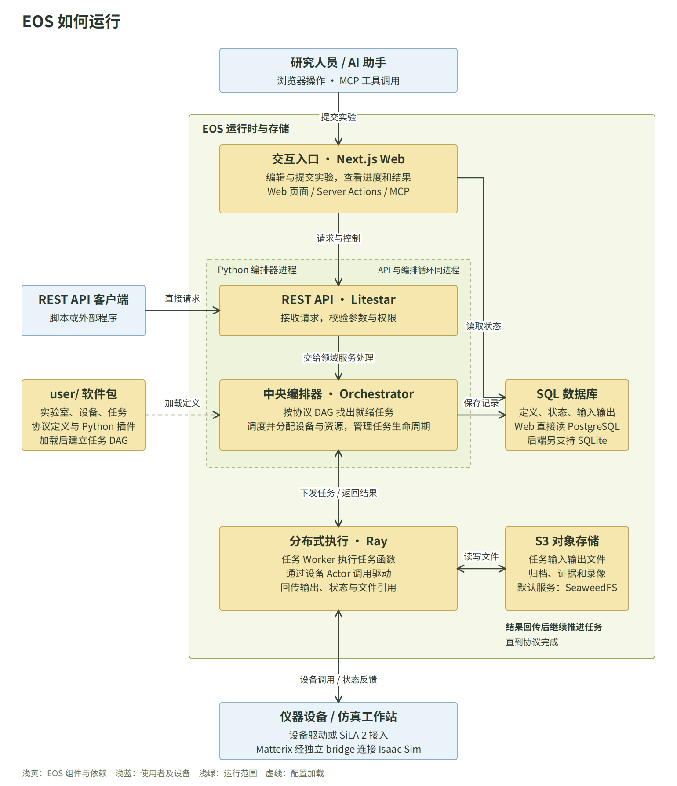
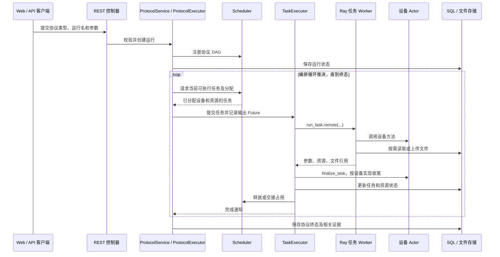
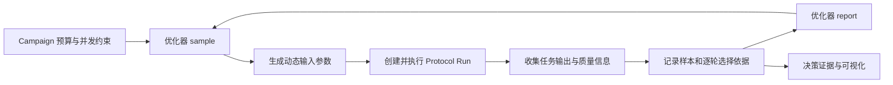

# EOS 项目架构分析

分析日期：2026-11-04。代码版本：`pyproject.toml` 声明为 `0.31.0`，当前 HEAD 为 `1209636`。

本文面向需要理解、维护和扩展 EOS 的开发者。分析对象是当前工作区，包含尚未提交的实现；因此只检出该 HEAD 不一定能复现本文描述的全部能力。本文依据源码、示例配置和仓库内文档进行静态分析，没有启动服务、运行测试或执行真实设备实验。

## 1. 架构结论

EOS 是面向实验室自动化的中央编排平台。它用插件表达实验室能力，用有向无环图表达实验流程，用调度器协调设备和资源，并通过 Ray 将任务和设备执行分布到不同计算机。Campaign 在协议执行之上增加多轮实验与优化反馈。

从进程与代码组织看，系统采用**模块化的 Python 编排核心、独立的 Next.js Web 服务，以及可选的外部设备和计算服务**。核心业务模块在同一编排器进程中协作；Ray 承担远程执行。REST API 与编排循环也在同一进程、同一 asyncio 事件循环中运行。

Web 服务端承担页面渲染、交互请求转发、数据库读取、文件操作和 MCP 接口。它直接读取 PostgreSQL，业务状态变更主要提交到 Python API。因此，理解该项目需要同时看 HTTP 调用关系与共享数据库关系。

主要判断及其依据：

| 判断                             | 源码依据                                                 | 实际含义                                                   |
| -------------------------------- | -------------------------------------------------------- | ---------------------------------------------------------- |
| 编排控制集中在单个运行实例       | `Orchestrator`、`run_eos`                                | 多台 Ray 节点扩展执行能力；控制层仍由中央进程推进          |
| 领域按服务、执行器、管理器拆分   | `orchestration/services/`、`*Executor`、`*Manager`       | 服务承接用例，执行器推进生命周期，管理器处理领域数据和状态 |
| 定义、运行状态、文件各有存储位置 | `PackageManager`、`DefSync`、SQL 接口、`FileDbInterface` | 磁盘插件是定义来源，SQL 保存可查询记录，对象存储保存文件   |
| 前后端共同依赖 SQL 表结构        | SQLAlchemy 模型、Drizzle schema                          | 修改表或状态字段时需同步检查 Python 与 TypeScript          |
| 外部依赖通过进程或协议隔离       | Matterix bridge、Atlas bridge、`verdi_run`               | 减少 Python 依赖冲突，同时引入独立部署和生命周期管理要求   |

入口证据：[编排器](../eos/orchestration/orchestrator.py)、[启动流程](../eos/cli/orchestrator_cli.py)、[Web API 组装](../eos/web_api/app.py)、[Web 数据库客户端](../web_ui/lib/db/client.ts)。

## 2. 系统全景



[可编辑矢量图（SVG）](_static/img/eos-architecture-overview.svg)

EOS 的运行主线是：用户提交实验，REST API 校验后交给中央编排器；编排器根据协议的任务依赖，调度设备和资源，再通过 Ray 执行任务、调用设备。任务结果返回后写入数据库，文件保存到 S3，编排器继续推进后续任务，直到协议完成。Web 通过 PostgreSQL 读取状态和结果；直接使用 REST 的客户端可跳过 Web。

运行前，EOS 会从 `user/` 加载实验室、设备、任务和协议定义。若提交的是 Campaign，系统会组织多次协议运行，并可根据结果由优化器生成下一轮参数。图中只展开一次协议运行的主线；API 与编排器位于同一 Python 进程，Ray 负责跨进程或跨机器执行。

### 2.1 目录与职责

| 目录                                   | 职责                                             | 关键入口                                                            |
| -------------------------------------- | ------------------------------------------------ | ------------------------------------------------------------------- |
| `eos/cli/`                             | 启动、环境配置、服务管理、数据库与用户管理       | `orchestrator_cli.py`、`services_cli.py`                            |
| `eos/configuration/`                   | 包发现、插件注册、配置校验、协议图、定义同步     | `configuration_manager.py`、`packages.py`、`protocol_graph.py`      |
| `eos/orchestration/`                   | 组件组装、主循环、领域用例入口                   | `orchestrator.py`、`services/`                                      |
| `eos/campaigns/`                       | 实验计划、多轮协议运行、优化结果回传             | `campaign_executor.py`、`campaign_manager.py`                       |
| `eos/protocols/`                       | 单次协议运行、任务依赖推进、仿真预检和证据整理   | `protocol_executor.py`、`preflight.py`                              |
| `eos/tasks/`                           | 任务定义、参数解析、生命周期、Ray 任务入口       | `task_definition.py`、`task_executor.py`、`task_runner.py`          |
| `eos/scheduling/`                      | 调度策略、占用索引、离线调度仿真、时长估计       | `base_scheduler.py`、`scheduler_factory.py`、`simulation.py`        |
| `eos/allocation/`                      | 设备与资源分配记录、人工预约                     | `allocation_manager.py`                                             |
| `eos/devices/`、`eos/resources/`       | 设备 Actor 管理、资源状态、耗材库存事件          | `device_manager.py`、`resource_manager.py`、`inventory.py`          |
| `eos/optimization/`                    | 优化器契约、贝叶斯算法、Beacon、Atlas 和 AI 连接 | `abstract_sequential_optimizer.py`、`sequential_optimizer_actor.py` |
| `eos/database/`                        | SQL 会话、数据库后端、迁移和对象存储             | `abstract_sql_db_interface.py`、`file_db_interface.py`              |
| `eos/auth/`、`eos/web_api/`            | 令牌校验、角色授权、REST 控制器                  | `authorization.py`、`app.py`                                        |
| `eos/approvals/`、`eos/notebook/`      | 审批记录与实验推理笔记的数据模型                 | `entities.py`                                                       |
| `web_ui/`                              | 页面、交互组件、服务端数据访问、MCP              | `app/`、`features/`、`lib/`                                         |
| `user/`                                | 实验室、设备、任务、协议和优化器插件             | `example/`、`matterix_sim/`                                         |
| `integrations/matterix/`               | 独立 SiLA 服务、会话与 Isaac Sim 进程管理        | `bridge/server.py`、`bridge/session_manager.py`                     |
| `tests/`、`web_ui/tests/`、`evidence/` | 自动化测试、前端逻辑检查和历史验收材料           | 按领域或验收场景组织                                                |

## 3. 领域模型与插件机制

### 3.1 从能力定义到运行实例

系统需要区分六个概念：

| 概念                    | 含义                     | 与其他对象的关系                                      |
| ----------------------- | ------------------------ | ----------------------------------------------------- |
| Package                 | 可复用的软件包           | 包含实验室、设备、任务、协议及辅助代码                |
| Lab                     | 实验室配置               | 指定计算机、设备实例、资源及是否为仿真环境            |
| Device                  | 有状态设备实例           | 由 Ray Actor 持有驱动对象，提供初始化、操作和清理能力 |
| Task                    | 最小执行单元及其运行记录 | 使用设备、参数、资源和输入文件，产生输出              |
| Protocol / Protocol Run | 流程定义 / 一次流程执行  | 流程由任务 DAG 组成；运行记录承载参数、状态和结果     |
| Campaign                | 多轮实验计划             | 创建多个 Protocol Run，并可根据输出调整后续输入       |

独立任务可以没有 Protocol Run；独立协议运行也可以没有 Campaign。不能用“所有任务都属于实验计划”的假设设计查询或关联。

### 3.2 配置和代码如何加载

`PackageManager` 在 `user_dir` 下发现带 `pyproject.toml` 的软件包。实验室和协议保留 `lab.yml`、`protocol.yml` 等声明式配置；设备和任务由 Python 插件提供。当前公开 API 为：

```python
from eos import task, Param, Context, File, Device, Resource
```

任务通过 `@task` 和函数签名声明参数与返回值；设备以 `Device` 为基类。注册层从 Python 定义生成 spec，供配置校验、编辑器和 API 使用。协议中的 `eos_dynamic` 允许运行时或优化器注入参数，`task_name.output_name` 等引用用于任务间传递数据。

`ConfigurationManager` 统一装配包管理器、任务与设备注册表、已加载实验室和协议。`DefSync` 将定义同步到 SQL 的 `definitions` 表，使 Web 可以查询定义而无需在 Node.js 中导入 Python 插件。

协议通过 NetworkX 建立 DAG，检查循环及引用顺序；引用另一个任务的输出，需要相应依赖关系保证该任务先完成。设备还可以提供 `check_plan` 进行领域顺序检查，例如移液阶段与一次性耗材使用约束。

这形成三种不同状态：**磁盘定义、内存中的已加载定义、数据库中的定义副本**。保存文件、同步定义和重新加载设备分别作用于不同位置，源码更新不会自动改变已运行的设备会话。

证据：[公开插件 API](../eos/__init__.py)、[包发现](../eos/configuration/packages.py)、[注册表](../eos/configuration/registries.py)、[配置管理器](../eos/configuration/configuration_manager.py)、[协议图与引用校验](../eos/configuration/protocol_graph.py)、[定义同步](../eos/configuration/def_sync.py)。

## 4. 编排核心与执行流程

### 4.1 启动与依赖组装

`run_eos` 读取配置后调用 `setup_orchestrator`，初始化编排器，再加载指定实验室和协议。`Orchestrator.initialize` 按依赖顺序完成：

1. 创建配置管理器，发现和加载插件。
2. 初始化 PostgreSQL 或 SQLite，执行定义同步，创建 S3 文件接口。
3. 连接现有 Ray 集群；连接失败时创建本地 Ray，使用 `eos` namespace。
4. 创建工作唤醒信号、分配管理器、设备和资源管理器、任务与运行管理器。
5. 创建调度器、任务执行器，以及协议和 Campaign 执行器工厂。
6. 创建各领域服务，将上次中断时仍处于运行中的任务、协议和 Campaign 标为失败。

依赖通过项目自有 `DIContainer` 注册，部分构造函数使用 `@inject` 获取依赖。`Orchestrator` 使用单例机制。这便于集中组装，但阅读构造函数时需同时检查容器注册位置，测试也需关注共享状态的隔离。

启动完成后，编排循环、Uvicorn API 和关闭事件监听作为 asyncio 任务并发运行。空闲时由 `WorkSignal` 等待新工作或维护超时；忙碌时按配置频率推进，默认上限为 10 Hz。

### 4.2 一次协议运行如何完成



该图描述正常成功路径；失败、取消和超时会进入各自的停止与清理流程。

`ProtocolExecutor` 负责依赖推进、输入解析、`run_if` 条件、跳过传播和协议终态。`TaskExecutor` 统一管理任务接纳、初始化、超时、重试、取消、结果写入和设备收尾。实际函数执行位于轻量模块 `task_runner.py`，避免 Ray Worker 因导入执行器而加载整个编排栈。

设备类由 `DeviceManager` 包装成具名 Ray Actor，按实验室配置绑定到本机 `eos` 资源或指定节点 IP 的资源。任务 Worker 通过代理调用 Actor，从而跨任务保留设备连接与状态。任务本身声明 `num_cpus=0`；CPU 配额不能直接作为任务并发上限，系统另有 `execution.max_concurrent_tasks`。

取消远程任务和停止真实操作是两个步骤。当前执行器会调用设备 `finalize_task`，由具体设备确认远端停止、整理输出和判断是否仍可用。重试受任务配置与设备状态约束；有部分执行副作用的动作，需要设备插件明确处理恢复和重复执行语义。

证据：[协议服务](../eos/orchestration/services/protocol_service.py)、[协议执行器](../eos/protocols/protocol_executor.py)、[任务执行器](../eos/tasks/task_executor.py)、[Worker 入口](../eos/tasks/task_runner.py)、[设备 Actor 创建](../eos/devices/device_manager.py)。

### 4.3 调度、占用和仿真

`SchedulerFactory` 提供 `greedy`、`heuristic`、`cpsat` 三种策略。共同的 `BaseScheduler` 维护协议注册、任务就绪状态、设备与资源占用索引、跨任务 hold、独立任务队列及状态版本。`AllocationManager` 维护相应的数据库分配记录与人工预约。

hold 用于某任务结束后仍保留后续任务需要的设备或资源，避免流程中途被其他运行抢占。调度器同时考虑协议内依赖和多个运行之间的竞争，不能只按 DAG 拓扑顺序直接启动所有就绪任务。

`TaskDurationEstimator` 可按历史已完成任务的实测时长更新后续规划所用的估计值。`scheduling/simulation.py` 提供离线调度仿真，用于检查策略、耗时和死锁；它与 Matterix 的物理仿真属于不同层次。

协议 `preflight` 则把同一流程映射到仿真实验室执行，成功后再放行原运行。映射校验要求相关目标实验室已经加载并标为 `simulated`，并检查设备匹配。它验证的是相应孪生环境中的执行结果，不能代替真实硬件验收。

证据：[调度器工厂](../eos/scheduling/scheduler_factory.py)、[共享调度机制](../eos/scheduling/base_scheduler.py)、[分配管理](../eos/allocation/allocation_manager.py)、[离线仿真](../eos/scheduling/simulation.py)、[协议预检](../eos/protocols/preflight.py)。

## 5. Campaign、优化与 AI

### 5.1 实验优化闭环



`CampaignExecutor` 管理多个协议执行器、运行预算、在途数量、失败限制及优化器异步请求。优化器运行在 Ray Actor 中，通过统一的顺序优化器接口提供 `sample`、`report` 和最优解查询。输入与输出按任务参数名关联，例如 `transfer_small.volume_ul`。

目前存在三类主要实现：

| 实现                          | 作用                                     | 依赖边界                                                       |
| ----------------------------- | ---------------------------------------- | -------------------------------------------------------------- |
| `BayesianSequentialOptimizer` | 单目标、多目标贝叶斯优化                 | EOS 环境内使用 BoFire 等依赖                                   |
| `BeaconOptimizer`             | 在算法建议与 AI 建议之间选择，并记录解释 | AI 请求失败时可返回基础优化器路径，失败会记录日志              |
| `AtlasOptimizer`              | 复用 Atlas / Olympus 规划能力            | 以独立 Python 解释器执行 `atlas_bridge.py`，通过 JSON 交换数据 |

`campaigns/decision.py` 从持久化记录组装逐轮证据，包含输入、目标值、质量资格、来源、选择依据与停止原因，当前窗口为最近 50 次运行。最佳值按后端、数据来源和模型版本分别计算；历史记录缺少依据时显示未知。AI review 使用这些证据生成解释，不能据此认定建议已经被执行。

### 5.2 AI 在系统中的位置

当前 AI 能力分布在协议草稿、Beacon 优化采样和决策解释中。协议草稿携带任务 spec、实验室场景能力和规则，生成后调用现有协议校验，并可将错误反馈给模型进行有限次数修正。

`OpenAIConnection` 提供 OpenAI 兼容协议与 Anthropic 协议的共享设置。设置默认持久化在服务端 `.eos/ai-settings.json`，采用私有文件权限和原子替换；管理接口返回密钥是否配置，不返回密钥值。这里的保护属于本地文件权限，并不表示密钥已经加密存储。

`approvals` 与 `notebook` 补充人机协作：笔记记录假设、设计、观察和决策；通过审批请求接口提交的实验，在全部实验室均为仿真时可直接进入执行，否则保存为待批准请求。**审批约束作用于该请求路径**；普通任务、协议和 Campaign 提交工具仍存在，不能把它描述为覆盖所有执行入口的统一审批网关。

证据：[Campaign 执行器](../eos/campaigns/campaign_executor.py)、[优化器接口](../eos/optimization/abstract_sequential_optimizer.py)、[Beacon](../eos/optimization/beacon_optimizer.py)、[Atlas](../eos/optimization/atlas_optimizer.py)、[决策证据](../eos/campaigns/decision.py)、[协议草稿](../eos/protocols/drafting.py)、[AI 设置](../eos/optimization/openai_connection.py)、[审批接口](../eos/web_api/controllers/approval_controller.py)。

## 6. 数据与一致性边界

### 6.1 三类持久化

| 存储            | 主要内容                                                                 | 主要使用方                                     |
| --------------- | ------------------------------------------------------------------------ | ---------------------------------------------- |
| 本地文件系统    | 插件代码、YAML、编辑器布局、AI 私有设置、外部 bridge 运行记录            | Python 配置层、Web 编辑器、bridge              |
| SQL 数据库      | 定义副本、运行状态、输入输出、分配、优化样本、权限、审批、笔记、库存事件 | Python；Web 服务端通过 Drizzle 读取 PostgreSQL |
| S3 兼容对象存储 | 任务文件、归档、录像等二进制产物                                         | Python 文件接口、任务 Worker、Web 文件接口     |

后端支持 PostgreSQL 与 SQLite；当前 Web 数据访问基于 `postgres-js`，因此后端的 SQLite 支持不等于整套 Web 可以直接切换到 SQLite。默认 Compose 使用 SeaweedFS 提供 S3 接口，并附带 Filestash 文件管理服务。

### 6.2 关键数据关联

`campaigns → protocol_runs → tasks` 是主要执行记录链，协议与任务允许独立存在。`campaign_samples` 与 `campaign_journal_entries` 保存优化反馈和解释；`devices`、`resources`、分配表与 `reservations` 保存设备资源视图；`definitions` 保存定义副本；`user_roles`、API token 和 identity 表承载本地授权与身份关联。

资源的 `meta` 还能承载耗材数量和任务边界快照。`inventory_events` 通过资源名与事件 ID 标识一次库存变化，事务中校验库存非负并避免同一事件重复扣减。它适合离散耗材计数；仿真液体体积等连续状态仍由设备或仿真侧维护。

SQL 会话上下文负责提交、回滚和关闭。对象上传、SQL 提交、Ray 执行及外部仪器动作之间没有在这些入口中形成统一分布式事务。因此，SQL 回滚无法撤回已发生的移液或自动删除已上传对象。失败恢复需要根据设备终态、运行记录和归档共同判断。

后端有 Alembic 迁移目录；初始化时的 `create_all` 用于创建缺失表，已有表结构升级仍需关注迁移。前端还维护独立 Drizzle schema 和 TypeScript 类型，不能只修改一侧模型。

证据：[模型注册](../eos/database/models.py)、[SQL 会话](../eos/database/abstract_sql_db_interface.py)、[文件接口](../eos/database/file_db_interface.py)、[库存事务](../eos/resources/inventory.py)、[前端 schema](../web_ui/lib/db/schema.ts)。

## 7. Web、认证与 MCP

### 7.1 前端组织和访问路径

`web_ui/app/` 定义路由、服务端页面和 API Route；`features/` 按任务、协议、Campaign、编辑器、资源、设备检查器等业务组织；`components/` 放共享组件；`lib/` 放数据库、API、认证、文件系统、MCP 和通用类型。

页面通常先在服务端查询首屏数据，再交给客户端组件交互。分页、筛选和排序通过 Server Action 重新查询。`features/*/api/*.ts` 文件名中的 API 经常表示服务端函数，不一定对应一个公开 HTTP 路由。

主要访问路径为：

- 列表、运行详情和定义读取：Server Action → Drizzle 查询 → PostgreSQL。
- 提交、取消、设备管理和运行控制：Server Action → `orchestratorPost/Get/...` → Python REST API。
- 编辑器文件读写：Next.js 文件接口或服务端函数 → `USER_DIR` 下的软件包文件。
- 日志：Web Route 代理后端 SSE；文件下载上传使用 S3 相关接口。

界面使用 React 19、Next.js 16，编辑器采用 Monaco 和 React Flow，客户端状态使用 Zustand，图表使用 ECharts / Chart.js。这些是当前依赖声明与源码组织的描述，不是对线上已部署版本的核验。

### 7.2 认证与授权

Web 使用 NextAuth 与 Zitadel OIDC，Python API 使用认证中间件校验令牌。两侧根据 EOS 本地角色表授权，角色包含 `VIEWER`、`SUBMITTER`、`EDITOR`、`LAB_ADMIN`、`SUPERUSER`；实验室管理还有面向具体实验室的检查。个人 API token 解析为所属用户，再使用该用户当前的本地权限。

关闭认证时，后端 guard 和前端授权辅助函数均有开发模式放行路径。`AuthConfig.enabled` 默认关闭；这会实质性改变访问边界，部署时必须确认前后端认证开关与身份配置一致。

MCP 由 `app/api/[transport]/route.ts` 承接，使用独立 Bearer 校验，并通过 AsyncLocalStorage 把调用者令牌传给编排 API。工具覆盖查询、运行、定义、设备、文件、仿真及 SDL 协作。SQL 工具额外检查超级用户，并使用专门的只读数据库连接。

需要注意，普通 Web 任务查询调用 `requireRole('VIEWER')`，而已检查的 MCP `list_tasks`、`get_task` 直接调用数据库查询函数，没有同样的本地角色检查。启用认证后 MCP 入口会验证 token，但身份有效与满足本地角色是不同条件。由此可确认两条读取路径的授权检查不同；本文未进行运行时越权测试，也未审计所有工具的可见范围。

证据：[任务 Server Action](../web_ui/features/tasks/api/tasks.ts)、[编排 API 客户端](../web_ui/lib/api/orchestrator.ts)、[Web 授权](../web_ui/lib/auth/authz.ts)、[Python 授权](../eos/auth/authorization.py)、[MCP 入口](../web_ui/app/api/[transport]/route.ts)、[MCP 任务工具](../web_ui/lib/mcp/tools/tasks.ts)、[MCP SQL 工具](../web_ui/lib/mcp/tools/sql.ts)。

## 8. Matterix 与外部计算集成

### 8.1 Matterix 的跨环境执行链

执行链为：`EOS Protocol → Matterix 任务 → MatterixWorkstation 设备 Actor → SiLA 2 bridge → 会话 Worker → Isaac Sim / Matterix`。

这条链涉及三个环境：EOS 自身的 Python 环境、bridge 所用的独立 ChemOS 环境，以及 Isaac Sim / Matterix 环境。bridge 使用独立环境的直接原因是 SiLA、protobuf 等依赖版本与 EOS 环境不同。设备通过协议通信，避免在编排器中直接导入 Isaac Sim。

`SessionManager` 管理会话、请求标识和 Worker 进程。一个 bridge 同一时间只允许一个活动会话。整站协议借助设备 hold 跨任务保持工作站独占；EOS 记录任务边界快照，连续仿真状态由 Matterix 维护。

设备收尾会查询或停止 bridge 请求、确认终态并下载证据。无法确认停止或归档失败时，设备会被阻止继续使用，需恢复或重新加载。协议层进一步汇总任务证据和录像。此处的外部生命周期处理是设备适配的一部分。

截至仓库内 2026-11-04 的报告，移液站已接入 PhysX 路径，但整站物理验收未通过：前门目标为 390 mm，记录实测约 2.835 mm，流程停止在第一阶段。本文未复测该结果。历史运动学录像、语义液量守恒、Mock 测量与真实物理或化学验收应分别解读。

证据：[设备适配器](../user/matterix_sim/devices/matterix_workstation/device.py)、[会话管理](../integrations/matterix/bridge/session_manager.py)、[bridge 部署与限制](../integrations/matterix/README.md)、[2026-11-04 物理验收记录](../evidence/matterix-physics-acceptance-20261104-d12ffa/README.md)。

### 8.2 Atlas 与 AiiDA

Atlas 每次建议调用独立解释器运行 bridge，输入输出使用 JSON，以隔离 torch、botorch、pandas 等版本。相应解释器及依赖需要部署到承载优化器 Actor 的 Ray 节点。

AiiDA 集成由 `verdi_run` 创建输入输出 JSON 文件，通过 `verdi run` 启动外部脚本。EOS 等待脚本结束并读取输出；AiiDA 的 profile、计算资源和工作流由其自身环境负责。源码中存在该接口，不代表真实 DFT/HPC 闭环已经完成验证。

证据：[Atlas 适配](../eos/optimization/atlas_optimizer.py)、[Atlas bridge](../eos/optimization/atlas_bridge.py)、[AiiDA 适配](../eos/integrations/aiida.py)。

## 9. 部署与运行边界

| 组件                     | 配置或默认入口                      | 部署说明                                                     |
| ------------------------ | ----------------------------------- | ------------------------------------------------------------ |
| Python 编排器及 REST API | `eos start`；默认 `localhost:8070`  | 控制循环与 API 同进程                                        |
| Next.js Web              | `eos start ui`；通常 3000           | 需要访问编排 API、PostgreSQL、S3；编辑器需要共享 `user` 目录 |
| PostgreSQL               | 根 Compose 默认宿主机 5432          | 当前本地 override 改为 5433；实际连接由配置决定              |
| SeaweedFS S3             | 根 Compose 映射 8333                | 保存文件和归档                                               |
| Filestash                | 根 Compose 映射 8334                | 文件管理辅助服务                                             |
| Zitadel 与登录页         | `docker/zitadel/docker-compose.yml` | 可选认证部署，支持外部身份服务配置                           |
| Ray                      | 连接现有集群，或本地初始化          | 设备按节点绑定；远程节点需要插件代码和对应依赖               |
| Matterix bridge          | 启动脚本默认 65200                  | 独立解释器；会话创建时启动 Isaac Worker                      |

`start_eos.sh` 组合启动基础服务、可选 bridge、Web 和前台编排器。默认加载移液站及配液 Mock；`--no-matterix` 仅加载 Mock。脚本会复用已监听端口的服务，因此端口已开放并不能证明进程加载了当前源码。

架构上的部署约束包括：

- 同一数据库与 Ray namespace 应由明确的编排实例管理。启动会将残留 RUNNING 工作置为失败，重复启动可能干扰正在运行的工作；脚本已有同机编排器检测。
- Web 与 Python 必须指向同一套 SQL、定义和文件存储，否则页面读取与执行控制可能出现不同视图。
- 修改 Next.js 源码后，生产模式需要重新构建；修改插件或 bridge 后，需要按其生命周期刷新或重启。不能中断正在执行的设备动作来完成更新。
- 多机部署需要同步插件依赖、外部解释器和资产路径。当前部分集成使用本机绝对路径，迁移机器时需逐项配置。
- 运行状态分布在 SQL、编排内存、Actor 和外部会话中。当前所读实现提供失败标记与显式恢复路径，尚无证据说明它支持多编排器主动接管和无缝高可用。

证据：[统一启动脚本](../start_eos.sh)、[基础服务 Compose](../docker-compose.yml)、[本地端口覆盖](../docker-compose.override.yml)、[Web Compose](../web_ui/docker-compose.yml)、[配置模型](../eos/configuration/eos_config.py)。

## 10. 架构评价与维护重点

### 10.1 有利于扩展的部分

任务、设备、协议与优化器具有明确的插件入口，实验逻辑通常可以放入 `user` 包，无需修改调度核心。协议图、调度分配与实际执行分离，使同一实验流程可以复用不同策略或设备实现。统一任务生命周期也给取消、超时和外部证据收集提供了公共接入点。

优化器和重型仿真依赖采用独立进程或服务隔离，解决了实验自动化中常见的环境冲突。定义 spec、数据库定义副本和 Web 编辑器共用同一组能力描述，有助于减少人工维护参数说明。

### 10.2 需要持续管理的耦合

| 维护重点               | 已观察到的原因                                 | 建议                                                       |
| ---------------------- | ---------------------------------------------- | ---------------------------------------------------------- |
| 前后端契约同步         | SQLAlchemy、Drizzle 和 TypeScript 类型分别维护 | 修改实体时一并检查迁移、前端 schema、序列化和展示          |
| 定义与运行实例版本一致 | 磁盘、内存、SQL 副本、bridge 各有状态          | 保留版本或哈希信息，更新时明确同步、重载和重启步骤         |
| 授权入口一致           | Web、Python API 与 MCP 存在不同读取路径        | 优先核对直接读取 SQL 和文件的 MCP 工具角色要求             |
| 审批适用范围           | 审批是独立提交路径，普通执行接口仍存在         | 若产品要求所有代理执行均审批，先明确入口政策再实现统一约束 |
| 外部动作恢复           | 数据库回滚无法撤回设备动作                     | 新设备必须定义停止确认、重复执行、副作用及人工恢复规则     |
| 共享控制状态           | 单例、全局 DI、内存队列与分配索引              | 保持单控制实例边界，针对并发取消和重启恢复做专项验证       |
| 独立环境可迁移性       | bridge、Atlas、Isaac 依赖额外解释器与资产      | 将部署清单落实到环境、文件、版本和节点位置                 |

这些建议是对当前结构的维护判断，不意味着必须拆分为更多服务。现阶段应先保持中央编排和插件边界清晰，在确认控制层容量或可用性需求后，再评估进程拆分。

### 10.3 常见变更应触达的位置

| 变更                   | 至少应检查的范围                                                              |
| ---------------------- | ----------------------------------------------------------------------------- |
| 新增任务或设备         | `user/<package>/`、spec 生成、参数与生命周期、实验室配置、局部契约测试        |
| 新增协议               | DAG、引用顺序、设备 hold、资源、`run_if`、设备 `check_plan`、示例输入         |
| 修改任务状态或运行实体 | Python entities / manager、SQL 迁移、Drizzle schema、Web 类型与查询、MCP 输出 |
| 新增调度策略           | `AbstractScheduler` / `BaseScheduler`、工厂与配置枚举、离线仿真和共享分配测试 |
| 新增优化器             | 顺序优化器接口、Actor 调用、Campaign sample/report、参数域与前端配置          |
| 修改 Matterix 能力     | 能力目录、任务模板、静态计划检查、bridge、设备收尾及相应层级验收              |
| 修改授权               | Python guard、Web Server Action / Route、MCP 直接读取和令牌转发路径           |

## 11. 分析方法与证据限制

本次使用 graphify 对 `eos/` 的 231 个 Python 文件进行结构提取，检测语料约 9.9 万词，未跳过敏感文件；该步骤没有调用外部模型 API。图中的 `Orchestrator`、`ConfigurationManager`、`BaseScheduler` 等高连接节点用于定位阅读入口，业务关系再通过源码核对。

提取诊断报告包含 874 条悬空端点边、11 条自环，以及转为有向简单图时可能合并的 319 条同端点关系边；4 个文件未提取出符号。因此该图仅作为导航，不用于证明完整调用覆盖、精确耦合指标或运行行为。图提取本身的模型 token 消耗为 0，不包含本文阅读和撰写的会话用量。前端另做了只读并行分析，本文所用关键访问与授权关系由主分析核对源码。

仓库内已有按配置、任务、协议、Campaign、优化、调度、认证、资源和外部集成划分的 Python 测试，Web 也有 Node 测试文件；本次只检查其组织和相关入口，没有执行这些测试。`evidence/` 是历史验收材料，本次引用不代表重新验收。

本次产物为本文档及配套系统全景图；未修改业务代码、运行配置或现有验收材料，未进行在线权限测试、压力测试、项目 AI 服务调用、Isaac Sim 运行或真机实验。调度离线仿真、Mock 闭环、物理仿真与真实设备验收应按各自证据范围解读。
