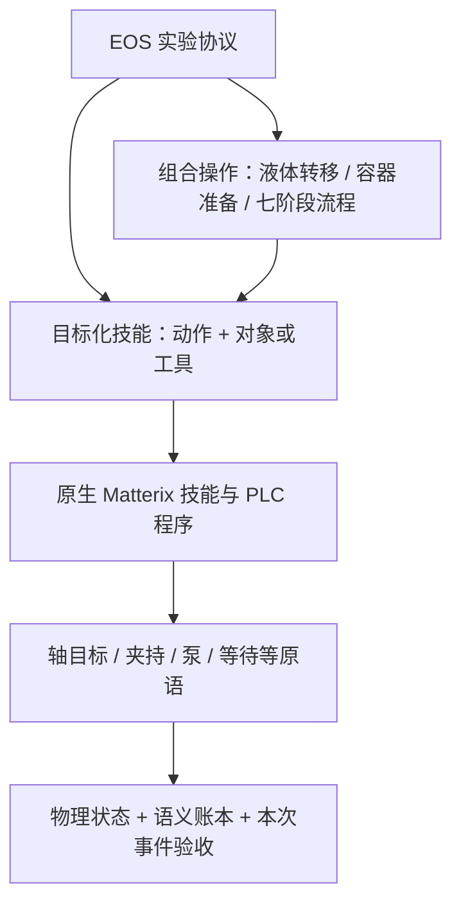

# EOS 移液站场景能力设计

更新：2026-11-11。范围：`PipettingStation_20261031` 参考包已有工作，不包含新增工艺或真机 PLC 接入。
本次已实现目标化技能绑定、编辑器联动、共享校验和整站原子技能示例；没有修改参考包或物理资产。

## 设计依据

Darvish 等，*MATTERIX: toward a digital twin for robotics-assisted chemistry laboratory automation*，
[论文与 DOI](https://doi.org/10.1038/s43588-025-00924-4)。通过 Zotero 本地库读取原文，条目 `FZXUK3EU`、PDF `RG83VB3Q`。
本设计采用 Results 的 “Manipulation and perception skills”、Fig. 4a、Methods 的
“Hierarchical state machine task representation”和物理与语义引擎相关章节。

论文给出的原则是：技能可复用且以目标为条件；工作流是有层级的树，叶子为原语，上层组合技能；
机器人工程师维护技能库，实验人员选择对象并组装流程；动作执行完成与目标状态达成共同决定成功。
液体吸吐还受物理条件约束，例如吸液端必须浸没。

以下对象命名、EOS 能力 ID、固定槽位限制和接口绑定是本项目的工程设计，并非论文提出的具体移液站接口。
论文中的 FoundationPose、IK、cuRobo、策略 checkpoint 和真机力反馈没有因此自动成为本场景已实现的能力。

## 能力层级

| 层次 | 用户可用内容 | 实现与责任 |
| --- | --- | --- |
| 实验边界 | 初始化、结束、取消后恢复 | EOS 独占设备；bridge 管理会话与重置验收 |
| 原子技能 | 夹取、放回、开盖、合盖、装耗材、吸液、吐液、弃置、前门、小盖头回位、等待 | EOS 可编排的最小实验语义动作；内部允许包含安全抬升等原语 |
| 组合操作 | TIP 完整转移、针筒过滤转移、原位取放、配液和七阶段操作 | 复用已有原生组合树，不作为单个吸液或夹持动作展示 |
| 设备程序与原语 | 17 条 PLC 程序，轴、夹爪、泵等控制 | 由参考包负责；实验编辑器不直接开放任意关节目标 |

这里的“原子”指 EOS 编排边界，不表示只能包含一条 PLC 指令。安全抬升、抓取准备开度和程序收尾继续留在技能内部。
等待不改变夹持和液量；前门只控制工作前门，不包含检修门。

## 对象与工具

| 实验对象 | 对应资产 | 技能操作位置 | 支持范围 |
| --- | --- | --- | --- |
| 10 mL 转移瓶 | `TransferBottle10ml_617` | 小瓶区 1 号位 | TIP 吸吐；针筒过滤吐液的固定接收瓶 |
| 50 mL 接收瓶 | `DesignC_BottleBody50ml_231` | 中瓶区1 的 1 号位 | TIP 吸吐，初始为空 |
| 2 mL 小瓶 | `DesignD_DesignC_ChromatographyVial2ml_190` | 出样区1 / 小开盖区 | 取放、开合盖；到小开盖区且已开盖后允许 TIP 吸吐 |
| 500 mL 大瓶 | `DesignD_DesignC_BottleBody500ml_238` | 大瓶区 / 大开盖区 | 取放、开合盖；到大开盖区且已开盖后允许 TIP 吸吐 |
| 八位反应器 | `EightPositionReactor_662` | 中瓶区2 的 1 号位 | 仅支持针筒吸液 |

“10 mL 转移瓶”是对象身份，不把它永久命名为母液或产物：TIP 转移时可以作液源，针筒过滤时又是接收器。
大开盖区和小开盖区是空工位，不是新的液源对象；大瓶的目标化液体操作始终绑定大开盖区，避免把开盖后留在工位的大瓶误当作仍在原槽位。

工具为 `移液器`、`针筒机构`；可装载耗材为 `TIP 1`、`TIP 2`、`针筒`、`过滤头`。
容器、针筒和过滤头仍固定到参考流程的 1 号位；只有两个已有 TIP 槽位开放选择。
没有新增任意索引，也不把对象表解释为对全站全部实物槽位的覆盖。

## 原子技能接口

| 能力 ID | 参数 | 绑定 |
| --- | --- | --- |
| `station_skill_pick` | `object` | 小瓶或大瓶的原生 Pick |
| `station_skill_place` | `object` | 小瓶或大瓶的原生 Place，放回原槽位 |
| `station_skill_decap` | `object` | 小瓶或大瓶的原生 Decap |
| `station_skill_recap` | `object` | 小瓶或大瓶的原生 Recap |
| `station_skill_mount` | `tool, consumable` | TIP 1/2、取针筒或装过滤头 |
| `station_skill_aspirate` | `tool, source, volume_ul` | 移液器从四类瓶取液；针筒仅从反应器取液 |
| `station_skill_dispense` | `tool, target, volume_ul` | 移液器向四类瓶吐液；针筒仅向 10 mL 转移瓶吐液 |
| `station_skill_discard` | `tool` | 弃置当前 TIP，或针筒连过滤头 |
| `station_skill_front_door` | `open_m` | 前门实际开度 0–0.39 m |
| `station_skill_small_cap_home` | 无动作参数 | 小盖头回 PLC 静息目标 |
| `station_skill_wait` | `duration_s` | 推进仿真并保持状态 |

前八项是新的目标化入口；后三项继续复用已有入口。体积仍为 20–180 µL。
`timeout_s`、`record_video`、`hide_shell` 沿用既有边界；录像在协议运行级设置。

`station_transfer_liquid(tool, source, target, volume_ul, tip_index)` 为组合操作：

- 移液器：装 TIP → 吸液 → 吐液 → 弃 TIP，可同容器自吸自吐，也可跨容器转移。
- 针筒机构：取针筒 → 反应器吸液 → 安装过滤头 → 向 10 mL 转移瓶吐液 → 弃置。
- `tip_index` 仅用于移液器；针筒路径不消费 TIP。

编辑器使用绑定表按工具联动对象、液源、目标和耗材选项；服务端独立拒绝不支持的组合。
例如 `移液器 + 八位反应器吸液`、`针筒机构 + 50 mL 接收瓶吐液` 均会在提交边界被拒绝。

## 参考包工作覆盖

已核对原生 `SKILL_CFGS` 全部 19 个构造器，已有七条注册工作流、探针组合及 `full_station()`。
正常工作内容由以下技能或组合覆盖；覆盖表示存在对应接口和执行路径，不表示本次已完成物理验收。

| 工作内容 | 新入口或保留的组合 | 关键约束 |
| --- | --- | --- |
| 前门开启、关闭 | 前门技能；七阶段开关门操作 | 测量实际关节位置 |
| 2 mL 小瓶取放、开盖、合盖 | pick/place/decap/recap | 开盖前取瓶，结束前合盖并放回 |
| 小盖头撤离 | small_cap_home | 保留原 PLC 静息目标 |
| TIP 装载、卸载 | mount/discard | 指定已支持 TIP 槽位，每次实验不能复用 |
| 小瓶区与中瓶区1 移液、自吸自吐 | aspirate/dispense；transfer_liquid | 液源有液、工具已装载且吐液量不超过持液量 |
| 小开盖区与大开盖区吸吐 | 选择实际小瓶或大瓶 | 容器先运到开盖位且真实开盖 |
| 大瓶取放、开盖、合盖 | pick/place/decap/recap | 大盖爪和抱瓶爪准备开度沿用参考技能 |
| 针筒取用 | mount(针筒机构, 针筒) | 筒身和活塞均夹持，耗材未使用 |
| 反应器取样 | aspirate(针筒机构, 八位反应器) | 针筒先吸液、后装过滤头；浸没由原资产继续校验 |
| 安装过滤头、过滤吐液、弃置 | mount / dispense / discard | 过滤头已装；固定向 10 mL 转移瓶吐液 |
| 独立原位取放、TIP 取放、开合盖循环 | 保留已注册的场景操作 | 保留原生动作变体和已有事件验收 |
| 参数化配液 | 保留 mixture_stock/diluent/close | 保留阶段顺序和不同 TIP 的消耗规则 |
| 七阶段整站流程 | 保留 matterix_full_station；新增 matterix_station_skills | 前者按阶段验收，后者逐项技能验收 |
| 等待、初始化、结束、取消与恢复 | 原有生命周期 + wait | 同一设备串行，部分移液不自动重试 |

27 条宏的分类：装/弃 TIP 2 条，移液器五个瓶区吸吐 10 条，小瓶开盖机构 4 条，大瓶机构 4 条，针筒过滤 5 条，反应器移液器吸吐 2 条。
最后两条虽然出现在 PLC 表中，但当前瓶类规划器无法对准反应器，明确不开放；反应器取样使用针筒路径。
大瓶区原槽位的吸吐宏仍由旧接口保留，并受盖状态和目标存在性检查约束；新接口选择实际容器在开盖工位的有效操作。

`syringe_filter_partial` 这类省略吸液却要求吐液的探针，不作为可从空针筒开始的正常工艺模板开放。
未启用的诊断流程不会因名字出现在参考源码中而自动获得可执行或已验收状态。

## 状态、失败与验收

新绑定在 `bridge/station_skills.py` 中定义，仍使用已有的 `RULES`：

1. 提交时校验参数类型、范围和对象/工具组合。
2. 静态计划检查将目标化调用绑定到同一原生技能，推演耗材、夹持、瓶盖与持液量。
3. 执行前在当前快照上检查对应原生技能的前置条件。
4. 构造同一个原生 Cfg 树，继续使用当前实际位姿修正和跨任务控制目标保持。
5. 执行后根据本次任务的事件增量、真实关节/装配状态及液量变化验收。
6. provenance 同时保留用户目标参数和解析后的 `skill_binding`，避免仅记录一个不明含义的通用动作名。

体积请求沿用参考控制器的 5 µL 转移容差；总量守恒和残液检查不放宽。
不通过静态检查不等于物理检查失败；通过静态检查也不保证可浸没、无碰撞或实际抓取成功。
失败、取消和中断保持原有冻结、归档、资源释放与恢复语义；没有加入自动补液、自动复用耗材或失败后继续运行。

旧 ID 继续执行，旧协议和历史证据不改写。具体对象命名的低层技能从编辑器隐藏；
两种原有完整转移由原子技能改分为场景操作。Franka 场景没有改变。

## 使用与验收范围

`user/matterix_sim/protocols/matterix_station_skills/protocol.yml` 展开参考七阶段工作的内容，共 26 个 EOS 任务。
每一步都持有同一工作站，最后释放；体积为 TIP 100/100 µL、针筒 50 µL。
小瓶取放开合盖、两次 TIP 取液与弃置、大瓶取放开合盖、针筒完整过滤链和门开合均独立可见。
安全抬升采用各原子技能自身约定，不能将这份展开协议理解为与七阶段演示逐控制步相同。

该协议是自定义原子技能流程，结束用 `expected_phase: 0`：仍检查任务成功、瓶盖关闭、夹持释放、耗材处置与液量状态，
但不要求七阶段计数器。已有 `matterix_full_station` 仍使用 `expected_phase: 7`。
在 EOS 中发现并加载新协议后即可提交；没有自动替换现有默认协议。

本次验证区分为：离线目录/接口与计划测试、Matterix 环境中的原生配置树验证、Isaac 动态运行、真机。
前两项执行；后两项未执行。构造树一致不能证明 PhysX 连续工作成功。
参考包旧门运动学/物理诊断记录不作为本次物理结论；本次未重新验收门行程或整站碰撞。

bridge 配置哈希覆盖能力表、绑定与 worker；已运行的旧会话不会自动更新代码。
应用新版本需要在工作站空闲且旧实验结束后按现有流程重启 bridge、重载实验室并更新 Web UI。
本次没有操作正在运行的服务。

### 本次检查结果

- 受影响及相邻的 12 个 Python 测试文件：203 passed、5 skipped、1 failed。
  失败为已有 `test_beaker_motion.py::test_saved_beaker_protocol_returns_to_support_with_catalog_defaults`：
  它读取未改动的 `protocols/test/protocol.yml`，假设每个任务有 `parameters`，当前保存协议不满足这个假设。
  没有改写该用户协议或删除失败测试。跳过项为原有运行环境门控测试。
- 所有 41 个目标绑定在已安装 Matterix / Isaac Lab 环境中验证原生 Cfg 树一致；另核验 19 个原生技能可达、17 条程序均在技能树中。
  普通 EOS 环境运行这些测试时，会在同一个测试进程组内调用 Matterix Python 完成配置树检查，不使用模拟构造器代替。
- 26 任务示例通过配置加载、设备占用和静态计划检查。
- 前端相关测试 39 passed；TypeScript、指定文件 ESLint、Prettier 与 `git diff --check` 通过。
- 新增技能/计划/编辑器 Python 代码的 Ruff 检查通过；其他被触及的 bridge 文件存在既有 lint 问题，未做无关全文件整改。
- 未跑全仓库测试、浏览器交互、Isaac 连续动态流程或真机；本次不声称获得这些层级的验收。
